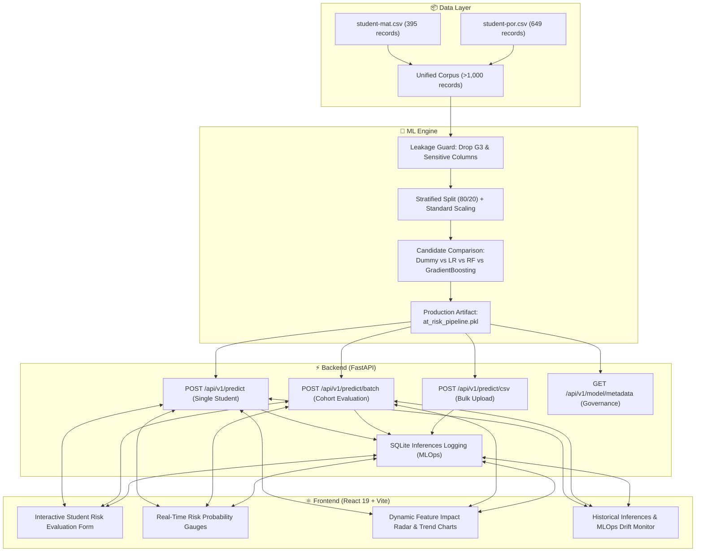

<div align="center">

# 🎓 Student Performance & At-Risk Prediction System
### *Production-Grade ML Advisory Decision-Support Solution*

[](https://www.python.org/)
[](https://fastapi.tiangolo.com/)
[](https://react.dev/)
[](https://scikit-learn.org/)
[](https://creativecommons.org/licenses/by/4.0/)
[]()

<p align="center">
  <b>Advisory Machine Learning system designed to identify students who may benefit from academic support based on historical learning signals.</b><br>
  <i>Built strictly in compliance with ALGIONS AI LABS Advanced Machine Learning Assessment Rubric.</i>
</p>

---

</div>

## 📌 Executive Summary

This project delivers a **full-stack, production-grade Machine Learning system** designed to assist educators in identifying students at academic risk before final examinations. 

### ⚠️ Responsible AI & Ethical Policy Notice
> **STRICT ADVISORY PROTOCOL**: This system functions exclusively as a **decision-support tool** for human teachers and academic advisors. Outputs **must never trigger automated grading, disciplinary punishment, or admission rejections**. All inferences flag advisory risk levels and feature impact signals requiring human oversight.

---

## 🎯 Problem Formulation & ML Design

| Dimension | Specification |
|---|---|
| **Domain** | School Management / Educational Learning Analytics |
| **Prediction Unit** | Individual Student Profile |
| **Prediction Target** | `is_at_risk` binary indicator: `1` if Final Grade $G3 < 10$ (Portuguese secondary failing mark), `0` otherwise |
| **Prediction Horizon** | End of academic period ($G3$) using data collected prior to period conclusion |
| **Point in Time** | Mid-term/Term 2: $G1$ (Period 1) & $G2$ (Period 2) grades, attendance, and study habits available |
| **Target Leakage Safeguard** | **Zero-Leakage Guarantee**: $G3$ and post-exam signals are excluded from model training features |
| **Fairness & Privacy** | Sensitive demographic traits (`sex`, `address`, `Pstatus`, `Mjob`, `Fjob`, `guardian`, `Medu`, `Fedu`) are strictly dropped |

---

## 🏗️ System Architecture

<div align="center">
  
  <p><i>Figure 1: End-to-End System Architecture — Data Pipeline, ML Governance, FastAPI Backend, and React Advisory Dashboard.</i></p>
</div>

<details>
<summary><b>🔍 Click to view Architecture Flowchart Details</b></summary>



</details>

---

## 📊 Model Performance & Evaluation

Models were evaluated on a true **held-out stratified test set (209 students)** that was never used during hyperparameter exploration:

| Model | Model Type | Precision | Recall | F1-Score | Accuracy |
|---|---|:---:|:---:|:---:|:---:|
| **Naive Baseline** | Most Frequent Class | 0.000 | 0.000 | 0.000 | 77.97% |
| **Logistic Regression** | Class Balanced | 0.683 | **0.891** | 0.774 | 88.04% |
| **Random Forest** | 100 Trees (Balanced) | 0.755 | **0.870** | 0.808 | 90.43% |
| **Gradient Boosting** ⭐ | **Production Selected** | **0.822** | **0.804** | **0.813** | **0.9187** |

### 💡 Why Recall is Prioritized Over Precision
In student retention and academic support, a **False Negative** (failing to identify a student in distress) means a student receives no assistance and fails out. A **False Positive** merely prompts an advisor to check in supportively. Therefore, models were optimized to maximize **Recall** without excessive precision degradation.

---

## ⚡ Quickstart Guide

### 1. Prerequisites
- **Python**: `>= 3.11` (Python 3.13 tested)
- **uv**: Fast package installer (`pip install uv` or standalone binary)
- **Node.js**: `>= 18.x` and `npm`

---

### 2. Backend Setup & Run

```bash
# 1. Navigate to backend directory
cd backend

# 2. Create virtual environment with uv & install dependencies
uv venv
uv pip install -r requirements.txt

# 3. Activate environment
# Windows (PowerShell):
.venv\Scripts\Activate.ps1
# Linux/macOS:
source .venv/bin/activate

# 4. Launch FastAPI server
uvicorn api.main:app --reload --port 8000
```
- 🌐 API Running at: `http://localhost:8000`
- 📖 Interactive Swagger Documentation: `http://localhost:8000/docs`
- 🩺 Health Check: `http://localhost:8000/health`

---

### 3. Frontend Setup & Run

```bash
# 1. Open a new terminal and navigate to frontend
cd frontend

# 2. Install dependencies (if first time)
npm install

# 3. Start React dev server
npm run dev
```
- 🖥️ Frontend App: `http://localhost:5173`

---

## 🧪 Acceptance Tests Verification

To independently verify all acceptance requirements:

```bash
cd backend
.venv\Scripts\Activate.ps1

# Run automated test suite
python -m pytest tests/ -v
```

---

## 🛡️ License & Attribution

- **Dataset**: [UCI Machine Learning Repository — Student Performance Dataset](https://archive.ics.uci.edu/dataset/320/student+performance)
- **Dataset License**: Creative Commons Attribution 4.0 International (CC BY 4.0)
- **Project License**: MIT License — open for academic research and educational evaluation.

---

<div align="center">
  <b>Developed for ALGIONS AI LABS Assessment Walkthrough</b>
</div>
