# 🏗️ Student At-Risk Prediction — Project Architecture & Mind Map
### Production-Grade ML System with MLOps

---

## 🛠️ Complete Technology Stack

> Every tool below is chosen for a specific reason. No tool is added for the sake of it — each one solves a real problem in a production ML system.

### 🐍 Core Language

| Tool | Version | Purpose |
|---|---|---|
| **Python** | 3.11 | Primary language for data science, ML, and API development. Industry standard. |

---

### 📦 Data & Processing

| Tool | Version | Purpose |
|---|---|---|
| **pandas** | 2.1.0 | Load, merge, clean, and transform tabular datasets. Used for all data manipulation. |
| **numpy** | 1.24.0 | Numerical operations, array handling, and mathematical computations under the hood. |

---

### 📊 Exploratory Data Analysis (EDA)

| Tool | Version | Purpose |
|---|---|---|
| **matplotlib** | 3.7.2 | Base plotting library. Used for grade distributions, learning curves, and ROC curves. |
| **seaborn** | 0.12.2 | Statistical visualisations — heatmaps, boxplots, countplots for EDA and class imbalance analysis. |

---

### 🤖 Machine Learning

| Tool | Version | Purpose |
|---|---|---|
| **scikit-learn** | 1.3.0 | Core ML library — Logistic Regression, Random Forest, preprocessing pipelines, metrics, train/test split, Dummy Classifier baseline. |
| **XGBoost** | 2.0.0 | Gradient boosted trees — the best-performing model. Handles mixed data, early stopping, and built-in regularisation. |
| **imbalanced-learn** | 0.11.0 | SMOTE (Synthetic Minority Over-sampling Technique) — generates synthetic at-risk samples to fix class imbalance in training data. |

---

### 🔍 Explainability

| Tool | Version | Purpose |
|---|---|---|
| **SHAP** | 0.43.0 | SHapley Additive exPlanations — explains WHY the model predicted a student is at-risk. Generates both global feature importance and individual prediction waterfall charts. Required by the assignment brief. |

---

### ⚡ Inference API

| Tool | Version | Purpose |
|---|---|---|
| **FastAPI** | 0.104.0 | High-performance REST API framework. Serves real-time predictions from the saved model. Auto-generates interactive Swagger UI at `/docs`. |
| **Uvicorn** | 0.24.0 | ASGI server that runs the FastAPI application. Handles incoming HTTP requests. |
| **Pydantic** | (via FastAPI) | Validates all API inputs and outputs using Python type hints. Prevents invalid data from reaching the model. |
| **python-dotenv** | 1.0.0 | Loads environment variables from `.env` file — keeps secrets out of source code. |

---

### 💾 Model Serialisation

| Tool | Version | Purpose |
|---|---|---|
| **joblib** | 1.3.2 | Saves and loads the trained model artifact (`best_model.pkl`). More efficient than pickle for large numpy arrays inside scikit-learn models. |

---

### 🧪 Testing

| Tool | Version | Purpose |
|---|---|---|
| **pytest** | 7.4.0 | Automated test framework. Runs unit tests for preprocessing, leakage checks, and API endpoint validation. |
| **httpx** | 0.25.0 | Async HTTP client used by FastAPI's `TestClient` to test API endpoints without running a live server. |

---

### 🧪 Experiment Tracking & Model Registry *(MLOps Phase)*

| Tool | Version | Purpose |
|---|---|---|
| **MLflow** | 2.8.0 | Logs all experiment parameters, metrics, and artifacts for every model training run. Provides a UI to compare runs. Also acts as a Model Registry — versions, stages (Staging → Production), and lifecycle management. |

---

### 🐳 Containerisation *(MLOps Phase)*

| Tool | Version | Purpose |
|---|---|---|
| **Docker** | Latest | Packages the FastAPI app, model artifact, and all dependencies into a single portable container. Guarantees the app runs identically on any machine or cloud host. |
| **Docker Compose** | Latest | Orchestrates multiple containers together — runs the FastAPI app and MLflow tracking server side by side locally. |

---

### 🔄 CI/CD Pipeline *(MLOps Phase)*

| Tool | Purpose |
|---|---|
| **GitHub** | Source control and remote repository. All code, notebooks, and config are version-controlled here. |
| **GitHub Actions** | Automated CI/CD pipeline — triggers on every push to `main`. Runs tests → builds Docker image → deploys to cloud. Zero manual deployment steps. |

---

### ☁️ Cloud Deployment *(MLOps Phase)*

| Platform | Purpose |
|---|---|
| **Render.com** | Free-tier cloud hosting for Docker containers. Provides a live public URL for the FastAPI app — required for the submission form's inference API/app URL field. |
| **HuggingFace Spaces** | Alternative free hosting option — supports FastAPI and Gradio apps. Good fallback if Render has cold-start issues. |

---

### 📡 Monitoring *(MLOps Phase — Optional but Impressive)*

| Tool | Version | Purpose |
|---|---|---|
| **Evidently AI** | 0.4.0 | Monitors live prediction data for data drift (when incoming student profiles start to differ from training data) and model performance degradation. Triggers retraining alerts. |

---

### 📁 Project & Environment

| Tool | Purpose |
|---|---|
| **Git** | Version control for all source files, notebooks, and configs. |
| **venv / pip** | Python virtual environment and package management. Keeps dependencies isolated per project. |
| **requirements.txt** | Pinned dependency list — ensures anyone who clones the repo gets the exact same package versions. |
| **.env.example** | Placeholder environment file — shows what variables are needed without exposing real values. |
| **Jupyter Notebook** | Interactive development environment for EDA, preprocessing, and model training notebooks. |

---

### 📊 Stack at a Glance

```mermaid
flowchart LR
    subgraph DATA["📦 Data Layer"]
        pandas
        numpy
    end

    subgraph EDA_BOX["🔍 EDA"]
        matplotlib
        seaborn
    end

    subgraph ML_BOX["🤖 ML"]
        scikit-learn
        XGBoost
        SMOTE["imbalanced-learn\nSMOTE"]
        SHAP
    end

    subgraph API_BOX["⚡ API"]
        FastAPI
        Uvicorn
        Pydantic
        joblib
    end

    subgraph TEST_BOX["🧪 Tests"]
        pytest
        httpx
    end

    subgraph MLOPS_BOX["🔁 MLOps"]
        MLflow
        Docker
        GitHub_Actions["GitHub Actions"]
        Render["Render.com"]
        Evidently["Evidently AI"]
    end

    DATA --> EDA_BOX --> ML_BOX --> API_BOX
    API_BOX --> TEST_BOX --> MLOPS_BOX
```

---

## 🧠 Big Picture Mind Map

```mermaid
flowchart TD
    ROOT["🎓 Student At-Risk Prediction\nProduction ML System"]

    ROOT --> A["📦 Phase 1\nData & EDA"]
    ROOT --> B["🤖 Phase 2\nML Pipeline"]
    ROOT --> C["⚡ Phase 3\nFastAPI Inference"]
    ROOT --> D["🔁 Phase 4\nMLOps & DevOps"]

    A --> A1["Raw Data\nUCI Student Dataset"]
    A --> A2["Data Merging\nMath + Portuguese"]
    A --> A3["EDA\nVisualisations + Insights"]
    A --> A4["Leakage Analysis\nFeature Safety Check"]

    B --> B1["Preprocessing\nEncoding + Scaling"]
    B --> B2["Feature Engineering\ngrade_trend, avg_grade..."]
    B --> B3["Model Training\nBaseline → LR → RF → XGB"]
    B --> B4["Evaluation\nPrecision/Recall/F1/AUC"]
    B --> B5["Explainability\nSHAP Values"]

    C --> C1["FastAPI App\nREST Endpoint"]
    C --> C2["Risk Banding\nLOW / MEDIUM / HIGH"]
    C --> C3["Advisory Note\nHuman Review Required"]
    C --> C4["Swagger UI\nInteractive Docs"]

    D --> D1["Experiment Tracking\nMLflow"]
    D --> D2["Model Registry\nMLflow Registry"]
    D --> D3["Containerisation\nDocker"]
    D --> D4["CI/CD Pipeline\nGitHub Actions"]
    D --> D5["Monitoring\nDrift + Performance"]
    D --> D6["Deployment\nRender / HuggingFace"]
```

---

## 📐 Full System Architecture — Layer by Layer

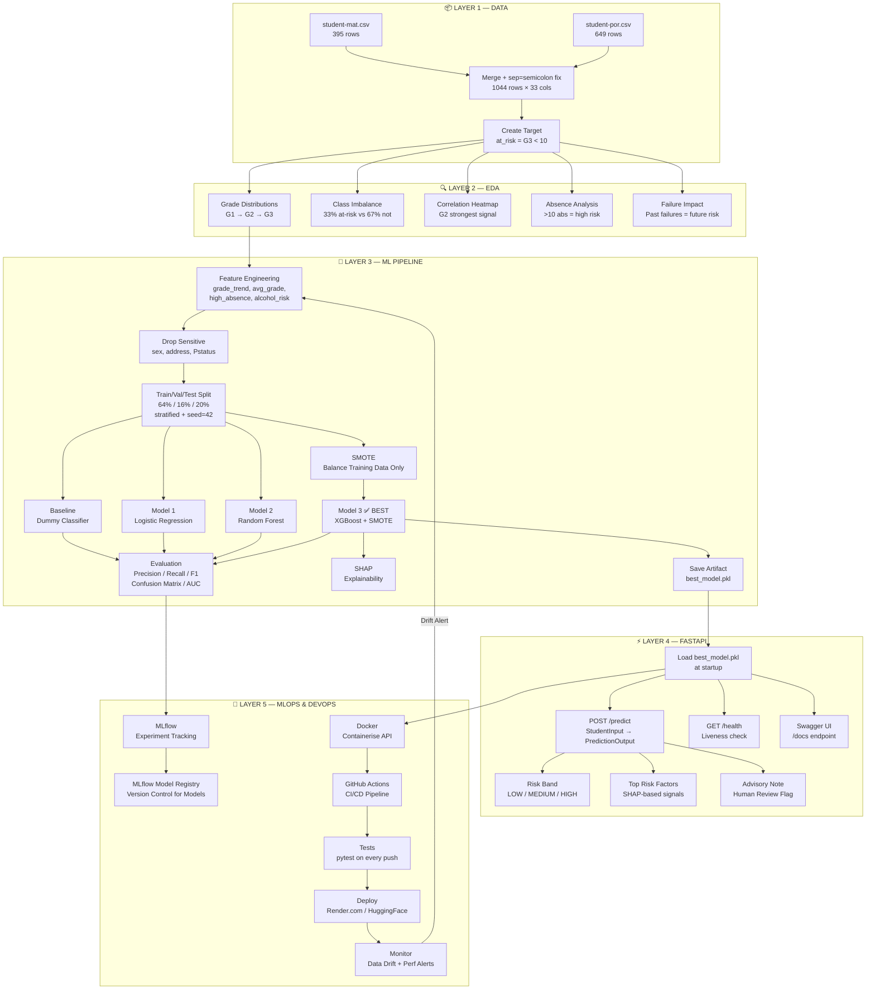

---

## 🗓️ Phase-by-Phase Execution Plan

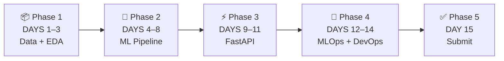

---

## 📦 PHASE 1 — Data & EDA (Days 1–3)

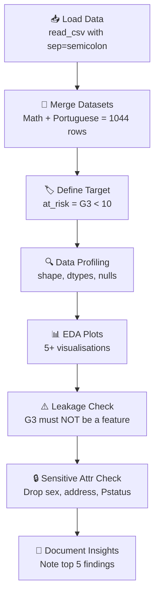

**Key Deliverables:**
- `data/processed/student_combined.csv`
- `notebooks/01_EDA.ipynb` with 5+ plots
- Leakage analysis written in notebook markdown

---

## 🤖 PHASE 2 — ML Pipeline (Days 4–8)

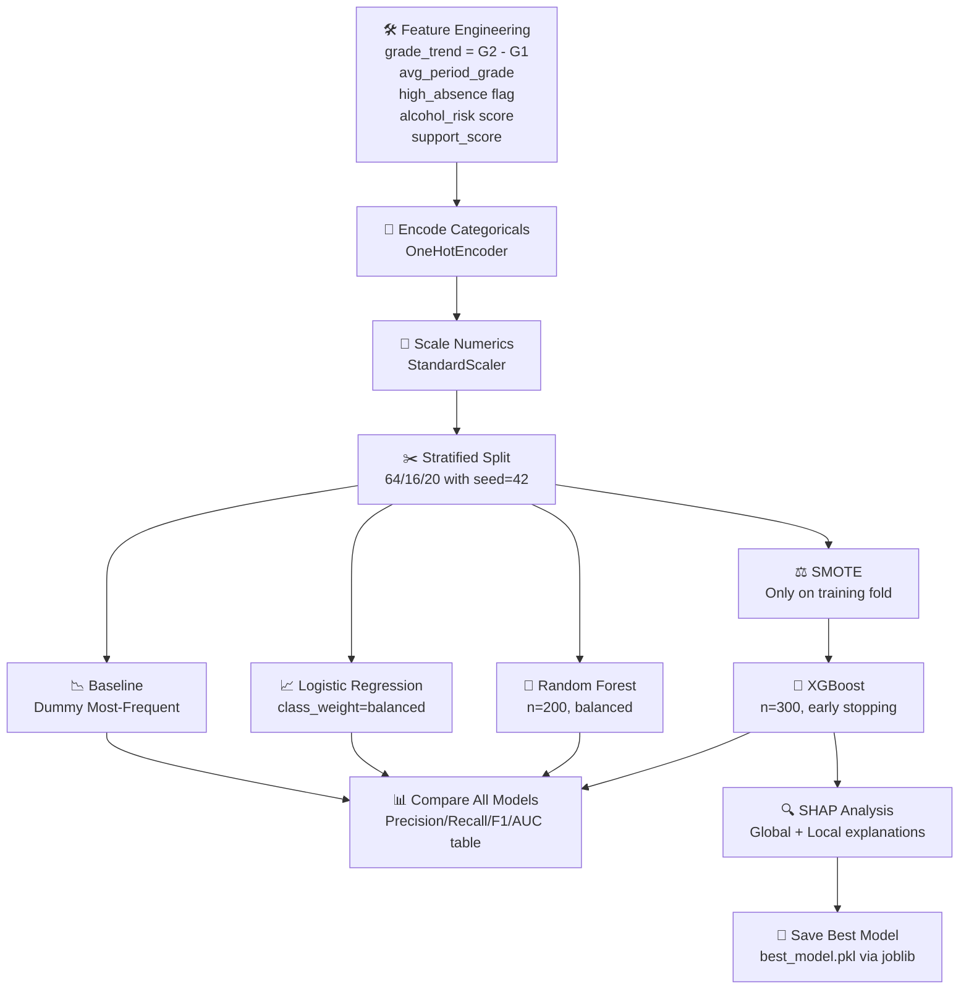

**Key Deliverables:**
- `notebooks/02_Preprocessing.ipynb`
- `notebooks/03_Modeling.ipynb`
- `src/data_prep.py`, `src/train.py`, `src/evaluate.py`
- `models/best_model.pkl`
- `reports/` — all plots + confusion matrices

---

## ⚡ PHASE 3 — FastAPI Inference (Days 9–11)

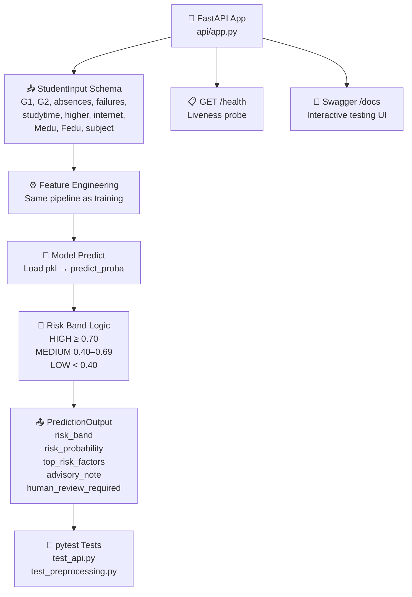

**Key Deliverables:**
- `api/app.py` — working FastAPI
- `api/schemas.py` — Pydantic models
- `tests/test_api.py`
- Swagger UI accessible at `/docs`

---

## 🔁 PHASE 4 — MLOps & DevOps (Days 12–14)

> This is what elevates your project from student assignment to production-grade system.

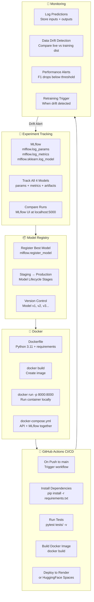

### MLOps Tools Stack

| Tool | Purpose | When |
|---|---|---|
| **MLflow** | Experiment tracking + model registry | Day 12 |
| **Docker** | Containerise FastAPI app | Day 13 |
| **GitHub Actions** | CI/CD — test + build + deploy on push | Day 13 |
| **pytest** | Automated tests in CI pipeline | Day 13 |
| **Render.com** | Free cloud deployment of Docker container | Day 14 |
| **Evidently AI** | Data drift monitoring (optional but impressive) | Day 14 |

---

## 🐳 Docker Architecture

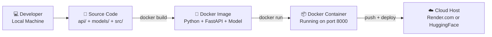

**Dockerfile (what it will look like):**
```dockerfile
FROM python:3.11-slim
WORKDIR /app
COPY requirements.txt .
RUN pip install --no-cache-dir -r requirements.txt
COPY . .
EXPOSE 8000
CMD ["uvicorn", "api.app:app", "--host", "0.0.0.0", "--port", "8000"]
```

---

## 🔄 GitHub Actions CI/CD Flow

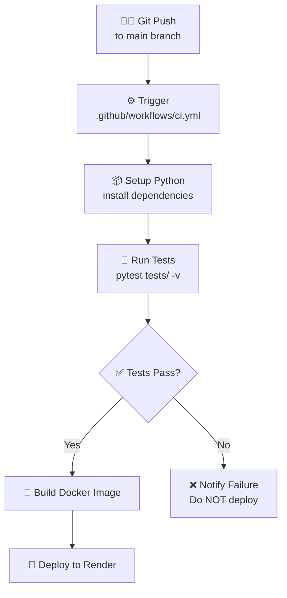

---

## 📡 MLflow Experiment Tracking Flow

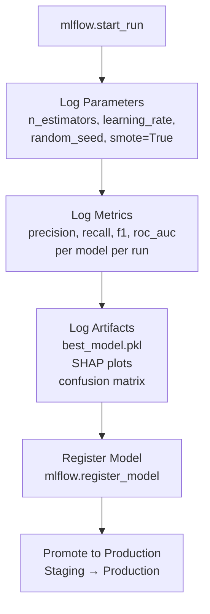

---

## 🗂️ Complete Technology Stack

| Layer | Technology | Why |
|---|---|---|
| **Language** | Python 3.11 | Industry standard for ML |
| **Data** | pandas, numpy | Data manipulation |
| **EDA** | matplotlib, seaborn | Visualisations |
| **ML Models** | scikit-learn, XGBoost | Proven algorithms |
| **Imbalance** | imbalanced-learn (SMOTE) | Class imbalance handling |
| **Explainability** | SHAP | Feature importance |
| **API** | FastAPI + Uvicorn | High-performance REST API |
| **Validation** | Pydantic | Input/output schema |
| **Model Saving** | joblib | Artifact serialisation |
| **Experiment Tracking** | MLflow | Track all runs + metrics |
| **Containerisation** | Docker | Reproducible deployment |
| **CI/CD** | GitHub Actions | Automated test + deploy |
| **Cloud Deployment** | Render.com | Free tier hosting |
| **Monitoring** | Evidently AI | Drift detection |
| **Testing** | pytest, httpx | Automated test suite |
| **Version Control** | Git + GitHub | Source control |

---

## 🔀 Data Flow — End to End

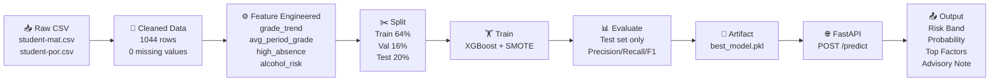

---

## ✅ What Makes This Production-Grade?

| Feature | Basic Project | Your Project ✅ |
|---|---|---|
| Fixed random seed | Maybe | ✅ seed=42 everywhere |
| Train/val/test split | Train/test only | ✅ 3-way stratified split |
| Leakage prevention | Not checked | ✅ Explicitly tested |
| Class imbalance handling | Ignored | ✅ SMOTE + class_weight |
| Model explainability | None | ✅ SHAP global + local |
| Ethical safeguards | None | ✅ Advisory note + bias checks |
| REST API | None | ✅ FastAPI with Pydantic |
| Automated tests | None | ✅ pytest suite |
| Experiment tracking | None | ✅ MLflow runs |
| Containerisation | None | ✅ Docker |
| CI/CD | None | ✅ GitHub Actions |
| Cloud deployment | None | ✅ Render.com |
| Drift monitoring | None | ✅ Evidently AI |

---

## 🎯 Recommended Build Order

```
STEP 1  →  Data loading + merging (fix sep=';')
STEP 2  →  EDA notebook (5+ plots, document insights)
STEP 3  →  Leakage + sensitive feature analysis
STEP 4  →  Feature engineering
STEP 5  →  Preprocessing pipeline (ColumnTransformer)
STEP 6  →  Baseline model
STEP 7  →  LR + RF + XGBoost training
STEP 8  →  Evaluation table (all 4 models vs test set)
STEP 9  →  SHAP explainability
STEP 10 →  Save best_model.pkl
STEP 11 →  FastAPI app (POST /predict endpoint)
STEP 12 →  pytest test suite
STEP 13 →  MLflow experiment tracking
STEP 14 →  Dockerfile + docker-compose
STEP 15 →  GitHub Actions CI/CD workflow
STEP 16 →  Deploy to Render.com
STEP 17 →  (Optional) Evidently AI drift monitoring
STEP 18 →  README, technical report, demo video
STEP 19 →  Final verification checklist
STEP 20 →  Submit!
```

---

> **When you are ready to build any step, just say:**
> *"Start Step 3"* or *"Build the FastAPI"* or *"Set up MLflow"*
> and I will generate the full code for that exact step.
